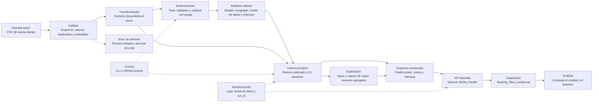

# Arquitectura de investigación SwarmTrader

**Datos.** La transformación produce factores causales por símbolo. Se selecciona por RMSE en validation y se conserva la evaluación de holdout. Inferencia utiliza el artefacto del Proyecto II. El informe incluye el tipo de fuente y los hashes necesarios para auditar el resultado.

**Control.** Con barras diarias y horizonte de 21 sesiones, el grueso del cálculo se ejecuta por lotes. El servidor responde lecturas HTTP contra un snapshot ya validado, con latencia y coste independientes de la llamada opcional de IA. La CLI publica cada resultado completo en un destino nuevo. El operador comprueba el `run_id` y conserva el informe anterior para recuperar el servicio.

**Negocio.** El analista usa el ranking para explorar resultados y compara el error con el baseline. El panel documenta cuándo se observó el último dato y qué limitaciones tiene la comparación. La evaluación sintética valida el funcionamiento del flujo.

[Prácticas E2E](https://github.com/dmartincc/dsia-26-27/tree/b76b9508acd7ecdf41da9890d35dfdefaa20847f/4_desarrollo_end_to_end/ejercicios) · [Contrato HTTP](../proyectos/proyecto_iii/API.md)
