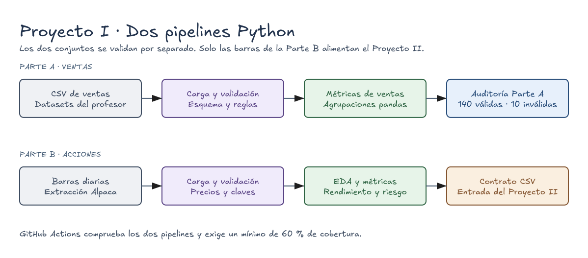
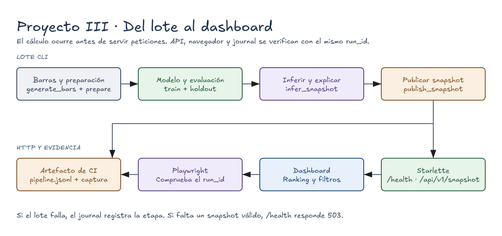

# Arquitectura de investigación SwarmTrader

Los tres diagramas se pueden abrir como escenas editables en Excalidraw. Las vistas previas SVG usan los contornos de [Excalifont, la tipografía manuscrita del editor](https://github.com/excalidraw/excalidraw/blob/9c2e462ec23e54c4cf0493328840d6a27191c674/dev-docs/docs/%40excalidraw/excalidraw/api/constants.mdx).

## Proyecto I · Dos pipelines Python

[Escena editable del I](diagramas/proyecto-i.excalidraw) · [Entrega del I](../proyectos/proyecto_i/README.md)

## Proyecto II · Entrenamiento e inferencia

**Datos.** La transformación produce factores causales por símbolo. Se selecciona por RMSE en validation. El holdout se evalúa una vez con el modelo congelado. La inferencia reutiliza ese artefacto. El informe incluye el tipo de fuente y hashes para comprobar su procedencia.

[Escena editable del II](diagramas/proyecto-ii.excalidraw) · [Entrega del II](../proyectos/proyecto_ii/README.md)

## Proyecto III · Lote y servicio HTTP

**Control.** Con barras diarias y horizonte de 21 sesiones, el cálculo se ejecuta por lotes. El servidor responde lecturas HTTP contra un snapshot validado. La latencia y el coste de esas lecturas son independientes de la llamada opcional de IA. La CLI publica cada resultado completo en un destino nuevo. El operador puede restaurar un snapshot anterior y comprobar el `run_id` con el smoke test.

**Operación.** La CLI registra cada etapa y su duración en `pipeline.jsonl` cuando recibe `--journal`. CI verifica que el último evento, `/health`, la respuesta HTTP y la página identifiquen el mismo snapshot. `as_of` indica la fecha del último dato. El journal registra un timestamp de ejecución en UTC.

**Negocio.** El analista explora el ranking y compara el error con el baseline en la ventana de validation. El panel muestra la procedencia de los datos y las limitaciones de la evaluación. La demo sintética valida el funcionamiento del flujo.

[Escena editable del III](diagramas/proyecto-iii.excalidraw) · [Despliegue y demo](../proyectos/proyecto_iii/README.md) · [Contrato HTTP](../proyectos/proyecto_iii/API.md) · [Prácticas E2E](https://github.com/dmartincc/dsia-26-27/tree/b76b9508acd7ecdf41da9890d35dfdefaa20847f/4_desarrollo_end_to_end/ejercicios)
