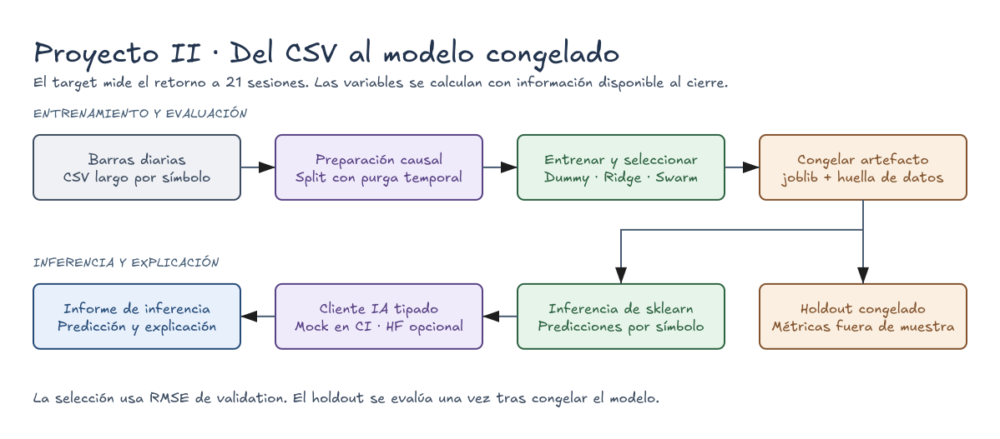

# Arquitectura de investigación SwarmTrader

`->` Los tres diagramas se pueden abrir como escenas editables en Excalidraw. Las vistas previas SVG usan los contornos de [Excalifont, la tipografía manuscrita del editor](https://github.com/excalidraw/excalidraw/blob/9c2e462ec23e54c4cf0493328840d6a27191c674/dev-docs/docs/%40excalidraw/excalidraw/api/constants.mdx). La leyenda de los marcadores está en el [README raíz](../README.md#leyenda-utilizada-en-la-wiki).

## Proyecto I · Dos pipelines Python

`>>` [Escena editable del I](diagramas/proyecto-i.excalidraw) · [Entrega del I](../proyectos/proyecto_i/README.md)

## Proyecto II · Entrenamiento e inferencia

`~>` **Datos.** La transformación produce factores causales por símbolo. Se selecciona por RMSE en validation. El holdout se evalúa una vez con el modelo congelado. La inferencia reutiliza ese artefacto. El informe incluye el tipo de fuente y hashes para comprobar su procedencia.

`>>` [Escena editable del II](diagramas/proyecto-ii.excalidraw) · [Entrega del II](../proyectos/proyecto_ii/README.md)

## Proyecto III · Lote y servicio HTTP

`->` **Cadena.** Ingesta → Procesamiento → Modelo / IA → API → Dashboard → Despliegue, con un módulo de `dsia_web` por etapa ([tabla en el README del III](../proyectos/proyecto_iii/README.md#arquitectura)).

`~>` **Control.** Con barras diarias y horizonte de 21 sesiones, el cálculo se ejecuta por lotes. El servidor responde lecturas HTTP contra un snapshot validado, así que la latencia y el coste de esas lecturas son independientes de la llamada opcional de IA. La CLI publica cada resultado completo en un destino nuevo. El operador puede restaurar un snapshot anterior y comprobar el `run_id` con el smoke test.

`>` **API.** Un solo proceso Uvicorn sirve el dashboard y estos endpoints, todos de lectura salvo el análisis. La tabla describe `v0.9.0-rc2`; con `e433fae`, el despliegue del 24/11/2026, `/health` no tiene `degraded`, `version` ni `commit`, y el análisis no tiene límite de uso ni el contexto del símbolo ([qué versión sirve Render](../proyectos/proyecto_iii/RELEASE.md#versión-desplegada)):

| Endpoint | Para qué |
| --- | --- |
| `GET /health` | `ready`, `degraded` (200, con la IA mal configurada o en fallo) o `unavailable` (503) con comprobaciones del snapshot, del journal y del proveedor de IA, sin rutas, más `version` y `commit` desplegados |
| `GET /api/v1/snapshot` y `/api/v1/snapshot/schema` | Informe completo validado y su JSON Schema |
| `GET /api/v1/predictions/{symbol}` | Predicción, posición en el ranking y resumen de entrada de un símbolo (nulo con datos de Alpaca) |
| `POST /api/v1/analyze` | Explicación bajo demanda con el `AIClient` del II (`mock`, Hugging Face o, como alternativa, NVIDIA con `AI_PROVIDER=nvidia`, la que usa Render), con los agregados del informe y el puesto del símbolo; `X-API-Key` si se define `DSIA_API_KEY`; `429` al superar el límite de uso, `503 analyze_busy` con el cupo de simultáneos lleno y `502`/`503`/`504` según el `kind` del fallo |
| `GET /api/v1/pipeline` | Últimos eventos del journal del lote |
| `GET /api/v1/metrics` | Peticiones por ruta y estado, latencia media y p95, `uptime_s`, `run_id`, `version`, `commit` y estado del límite de uso |

`>` **Operación.** La CLI registra cada etapa y su duración en `pipeline.jsonl` cuando recibe `--journal`; `validate_input` registra filas, símbolos y hash de la entrada, y `download_bars` los agregados de la descarga de Alpaca. Cada petición HTTP deja una línea de log con `request_id` y latencia, y responde con cabeceras de seguridad. El panel **Operación** del dashboard lee `/health`, `/api/v1/metrics` y `/api/v1/pipeline`. El CI verifica que el último evento, `/health`, la respuesta HTTP, el panel y la página identifiquen el mismo snapshot. `as_of` indica la fecha del último dato y el journal, la hora de ejecución en UTC.

`>` **Despliegue.** El [Dockerfile](../proyectos/proyecto_iii/Dockerfile) genera un snapshot en el build (la demo, o datos reales si se monta el secret file de Alpaca) y arranca con [`serve.py`](../proyectos/proyecto_iii/dsia_web/serve.py), que con las claves de Alpaca en el entorno descarga las barras hasta la última sesión cerrada, reentrena y publica antes de lanzar Uvicorn (desde `v0.9.0-rc2`, en un proceso hijo con el tope de `DSIA_REFRESH_TIMEOUT`; si vence, sirve el informe de la imagen), con un usuario sin privilegios y un `HEALTHCHECK` contra `/health`. [render.yaml](../render.yaml) despliega esa misma imagen en Render ([https://dsia-swarmtrader.onrender.com](https://dsia-swarmtrader.onrender.com)). El [Procfile](../Procfile) arranca sin contenedor en un runner con `proyectos/proyecto_ii/requirements.txt` instalado: genera la demo si falta y lanza Uvicorn en `$PORT` con `--no-access-log`, sin refresco de Alpaca ([Empaquetado](../proyectos/proyecto_iii/README.md#empaquetado)). El CI construye la imagen y pasa el smoke contra el contenedor. El diagrama SVG muestra el flujo hasta la evidencia de CI; el contenedor y Render son el destino de ese mismo servicio.

`=>` **Negocio.** El analista explora el ranking y compara el error con el baseline en la ventana de validation. El panel muestra la procedencia de los datos y las limitaciones de la evaluación. Con datos reales de Alpaca el informe público solo contiene predicciones y métricas, porque la licencia no permite redistribuir precios.

`>>` [Escena editable del III](diagramas/proyecto-iii.excalidraw) · [Despliegue y demo](../proyectos/proyecto_iii/README.md) · [Contrato HTTP](../proyectos/proyecto_iii/API.md) · [Prácticas E2E](https://github.com/dmartincc/dsia-26-27/tree/b76b9508acd7ecdf41da9890d35dfdefaa20847f/4_desarrollo_end_to_end/ejercicios)
