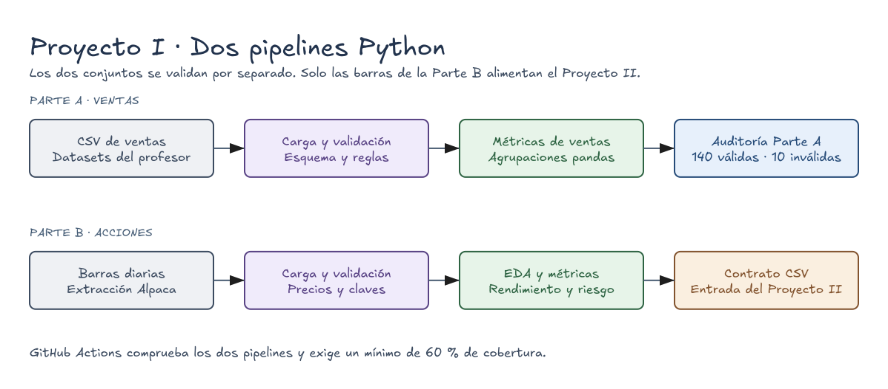
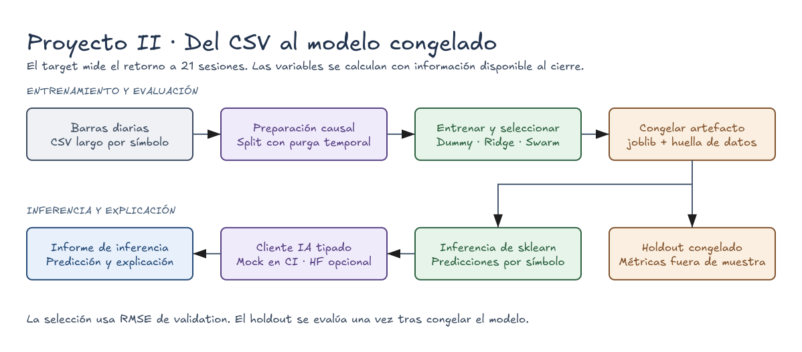
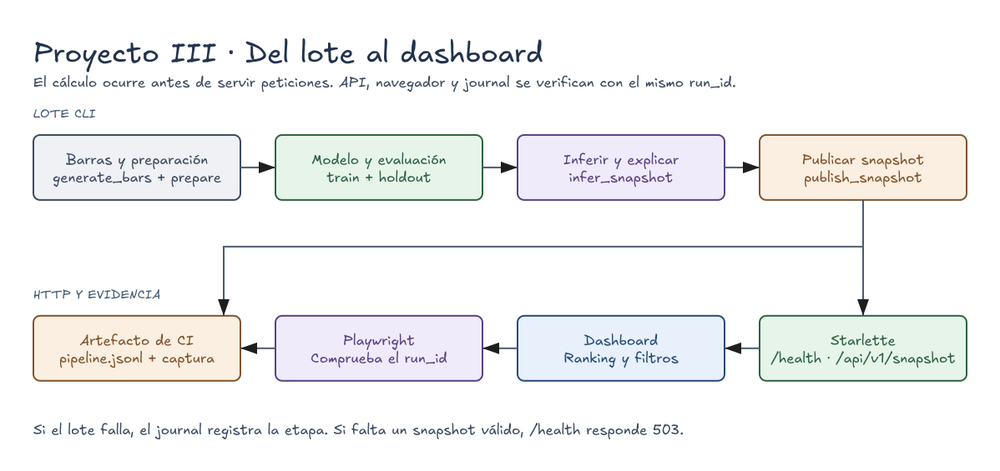

# Proyectos de Desarrollo de Soluciones de IA

Esta carpeta reúne las tres entregas de DSIA. El Proyecto I desarrolla dos pipelines de calidad de datos, uno de ventas y otro de acciones. El II usa el contrato de barras de la Parte B para entrenar y evaluar un modelo de retornos. El III reutiliza el modelo y la inferencia del II para mostrar sus resultados en una aplicación web.

| Proyecto | Peso en la asignatura | Qué se entrega |
| --- | --- | --- |
| [I · Programación avanzada en Python](#proyecto-i) | 10 % | Dos CLI de validación y métricas, con pruebas por módulo |
| [II · Automatización e integración](#proyecto-ii) | 20 % | Un pipeline reproducible de scikit-learn y un cliente de IA tipado |
| [III · Desarrollo end-to-end](#proyecto-iii) | 40 % | Un pipeline batch, una API y un dashboard con pruebas de extremo a extremo |

## Proyecto I

Implementa dos flujos independientes que comparten el patrón de carga, validación, métricas y CLI.

| Parte | Entrada y validación | Resultado |
| --- | --- | --- |
| **A · Ventas** | CSV del curso. Valida el esquema y comprueba que las unidades, los precios y los importes sean positivos y finitos | Exporta ventas válidas y rechazadas con su motivo. Calcula importe por región, top 3 de productos por importe y clientes con compras repetidas. El test de integración verifica **140 filas válidas y 10 inválidas** |
| **B · Acciones** | Barras diarias OHLCV de Alpaca. Valida tipos, coherencia de precios y clave única por símbolo y fecha; un `vwap` fuera de `[low, high]` solo genera un aviso | Calcula rentabilidad del precio, volumen medio diario y volatilidad anualizada por símbolo. Incluye un extractor documentado y una muestra sintética versionada (`data/sample/acciones_muestra.csv`, sin cotizaciones de Alpaca) para ejecutar la CLI sin red |

Pytest cubre la carga, la validación, las métricas y la CLI de ambas partes. GitHub Actions ejecuta la suite conjunta, exige un mínimo del **60 %** de cobertura y lanza las dos CLI de extremo a extremo sin red.

[Guía de ejecución y tests](proyecto_i/README.md) · [Origen y extracción de barras](proyecto_i/ALPACA.md) · [Uso de IA](proyecto_i/AI_USAGE.md) · [Diagrama editable en Excalidraw](../docs/diagramas/proyecto-i.excalidraw)

## Proyecto II

Automatiza una tarea de investigación de SwarmTrader. A partir de barras diarias, estima para cada símbolo el **retorno del precio a 21 sesiones**.

1. **Preparación.** La CLI valida el CSV y construye factores con la información disponible al cierre de cada sesión. Separa train, validation y holdout por fecha y purga las etiquetas que cruzan sus fronteras.
2. **Entrenamiento y evaluación.** Compara Dummy, Ridge y Swarm por RMSE en validation. Persiste el candidato elegido en `model.joblib` y evalúa el holdout una sola vez con el modelo ya congelado, junto a un baseline que predice la media de train. La guía incluye la receta y las métricas de una demo sintética reproducible, y la CLI registra cada etapa en los logs (`--log-level`).
3. **Inferencia y explicación.** Recarga el artefacto para producir estimaciones por símbolo. Un cliente de IA tipado explica un resumen después de inferir. Los tests y CI usan `mock`; la integración opcional con Hugging Face está documentada en la guía.

[Guía de reproducción](proyecto_ii/README.md) · [Contrato de datos](proyecto_ii/data/README.md) · [Uso de IA](proyecto_ii/AI_USAGE.md) · [Diagrama editable en Excalidraw](../docs/diagramas/proyecto-ii.excalidraw)

## Proyecto III

Convierte el flujo del II en una aplicación end-to-end. El dashboard permite explorar el ranking de retornos estimados, filtrar símbolos y consultar su procedencia, el baseline y las métricas de evaluación.

1. **Lote e informe.** La demo entrena y evalúa con datos sintéticos. El modo `from-run` reutiliza un modelo del II y sus métricas de holdout con el histórico autorizado. Ambos publican un snapshot versionado antes de servir peticiones.
2. **API y dashboard.** Starlette sirve el informe en `/api/v1/snapshot`, la predicción de un símbolo en `/api/v1/predictions/{symbol}` y una explicación bajo demanda con el cliente de IA del II en `POST /api/v1/analyze`. `/health` devuelve el estado con sus comprobaciones, `/api/v1/pipeline` los últimos eventos del lote y `/api/v1/metrics` contadores y latencias. El dashboard lo carga todo por HTTP: ranking, datos de entrada, el formulario «Explicar símbolo» y el panel **Operación**.
3. **Operación y despliegue.** El journal JSONL registra el estado y la duración de las etapas, y cada petición deja un log con `request_id` y latencia. GitHub Actions genera la demo y Playwright verifica que el informe publicado, la API, el panel de operación y la página muestran el mismo `run_id`; otro job construye la imagen Docker y pasa el smoke contra el contenedor. La guía documenta arranque local, Docker, Render, Procfile, smoke test y recuperación con un snapshot anterior. Todavía no hay URL pública.

[Arranque y demo](proyecto_iii/README.md) · [Contrato HTTP](proyecto_iii/API.md) · [Release Candidate y defensa](proyecto_iii/RELEASE.md) · [Evidencia agregada del histórico](proyecto_iii/evidencia/historico_alpaca.json) · [Uso de IA](proyecto_iii/AI_USAGE.md) · [Diagrama editable en Excalidraw](../docs/diagramas/proyecto-iii.excalidraw)

## Verificación de las entregas

La matriz de trazabilidad enlaza los enunciados docentes de los Proyectos I, II y III con el código, las pruebas y la documentación correspondiente. La ejecución verificada de GitHub Actions incluye las tres suites y el artefacto del III con la captura del dashboard y el journal de la demo.

[Matriz de trazabilidad](../docs/TRAZABILIDAD_DSIA.md) · [Workflow](../.github/workflows/ci.yml) · [Último run verde de `main`](https://github.com/dalonsogomez-ai/dsia-26-27-alonso-daniel/actions/runs/45227267528) · [Repositorio de entrega](https://github.com/dalonsogomez-ai/dsia-26-27-alonso-daniel)
