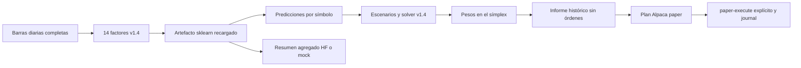

# -> Elección por convicción y asignación de capital

~> Requisito incorporado el 12/11/2026: elegir aunque no exista ventaja demostrada, sin diversificación obligatoria. Se aplica al Proyecto II en el repositorio del alumno; el repositorio externo de SwarmTrader no se modifica. Referencia: [SwarmTrader v1.4.0, commit fijado](https://github.com/dalonsogomez-ai/swarmtrader/tree/5642dda71a1e50d55da3ad1206ec2ae1b891ac28).

## > Diagnóstico de v1.4

El modo upstream `gated` puede abstenerse: G4 verifica si los primeros valores superan al universo. Su auditoría publicada da **NO ACCIONABLE**. v1.4 ya ofrece `--decision conviction`: el veredicto se informa, pero no veta la asignación. La incertidumbre no equivale a una prohibición de elegir. Tampoco convierte las probabilidades o medias estimadas en certezas.

Esta entrega predice retornos con sklearn y aplica el optimizador v1.4. No vuelve a calcular G0–G4: el campo de investigación informa «ventaja no demostrada», no una certificación estadística nueva. Las noticias, fundamentales, contratos/opciones y agentes profundos del original no están en el predictor académico; «universo analizado» significa exactamente los símbolos y las 14 features del CSV validado.

## > Criterio matemático

Para escenarios de retorno bruto positivos `X[s,i]=1+R[s,i]`, se resuelve:

\[
\max_{w\in\Delta^n}\frac1S\sum_{s=1}^S u_\gamma\!\left(\sum_i w_iX_{s,i}\right),
\quad\Delta^n=\{w\ge0,\ \sum_iw_i=1\}.
\]

`gamma=1` utiliza `u(x)=log(x)` (Kelly); `gamma=0` maximiza riqueza esperada y elige un vértice, el activo de mayor media. Para otros gamma se utiliza CRRA, `(x^(1-gamma)-1)/(1-gamma)`. No se añade un tope por activo, un mínimo de posiciones, un término que fuerce diversidad ni efectivo obligatorio. La formulación logarítmica y la comparación con carteras constantes tienen su fundamento en [Cover, Universal Portfolios](https://isl.stanford.edu/~cover/papers/universal_portfolios.pdf). Se adopta el criterio de elección, no sus garantías asintóticas para este predictor finito.

En Kelly, por concavidad, las condiciones KKT son suficientes:

\[
E[X_i/(w^\top X)]=1\ \text{si }w_i>0,\qquad
E[X_i/(w^\top X)]\le1\ \text{si }w_i=0.
\]

Por tanto, un vértice `w=e_j` es óptimo si `E[X_i/X_j] <= 1` para todo i. Si alguna desigualdad se viola, mover capital a ese activo mejora el objetivo. Así aparece una o varias posiciones por la función objetivo. Una combinación que reduce fluctuaciones puede aumentar el crecimiento geométrico aunque tenga menor media aritmética. Con gamma=0 solo importa esta última: incluso si todas las medias son negativas, se elige la menos negativa al imponer inversión completa. En empates verdaderos no existe una superioridad deducible de los datos; el orden alfabético estabiliza el desempate numérico.

El solver upstream usa pasos multiplicativos y Frank–Wolfe y devuelve una brecha de suboptimalidad. Tolerancia `1e-7` en utilidad, no rentabilidad prometida. Los tests contrastan un vértice, un interior, medias negativas y una solución independiente SciPy/SLSQP. «Óptimo» se refiere al problema finito de escenarios, dentro de esa tolerancia; no certifica el mejor futuro real. Si `converged=false`, el informe conserva la brecha y no afirma convergencia.

## > Por qué no softmax, L1 o un nuevo LTR

Softmax con temperatura positiva reparte peso entre todos los activos y no entrega ceros exactos. Llevar la temperatura a cero selecciona un máximo, pero no decide cuándo una combinación mejora el crecimiento. [Sparsemax, Martins y Astudillo (ICML 2016)](https://proceedings.mlr.press/v48/martins16.html) sí proyecta sobre el símplex y produce ceros; no sustituye por sí mismo una distribución financiera y una utilidad. Una penalización L1 tampoco genera selección en el símplex long-only: `||w||1=1` es constante. L0 crea un problema combinatorio y no es necesario para admitir concentración.

El ranking es una entrada a la decisión, no su función objetivo. Implementar ListNet/LambdaMART adicional no garantiza un ranking correcto ni probabilidades calibradas y añadiría otro modelo a validar. Se reutilizan los especialistas v1.4 y sklearn, conforme al enunciado. Máxima probabilidad de superar +5 %, máxima media y máximo crecimiento logarítmico son objetivos distintos; el informe no los confunde.

## > Escenarios y dos fuentes de media

1. `--mean-source model` (defecto): las medias son los retornos sklearn. Se reutiliza `_ScenarioBank` del código v1.4 fijado: bootstrap estacionario de secciones diarias, composición a 21 sesiones y mapa de incertidumbre estimado con validation fuera de muestra cada 21 fechas. Cada columna se reescala para que su media de retorno coincida exactamente con sklearn. La dependencia conjunta proviene de la historia disponible, con hasta 1.260 sesiones. Esto es una adaptación explícita: las medias no tienen calibración acreditada y un error del predictor afecta a la cartera.
2. `--mean-source empirical`: se llama a `allocate` original íntegro, con mapa empírico por percentiles y encogimiento. Con diez símbolos no hay soporte para sus tramos; el mapa queda plano y lo explica el informe. Elegir sigue siendo posible, pero no se atribuyen diferencias de media a los scores. No se reduce arbitrariamente el soporte mínimo para fabricar una ventaja.

Ambos modos usan semilla 0 y 3.000 escenarios por defecto. La fuente se elige explícitamente y queda registrada; no se cambia según el resultado del test. La `p_success` de la tabla es la frecuencia de escenarios con retorno >5 % en 21 sesiones: es una estimación condicional, no una probabilidad de acierto calibrada en mercado. El mapa se construye con validation utilizada para seleccionar el modelo y **no es una auditoría independiente de cartera**. No se ha realizado backtest OOS de esta asignación académica.

## > Conexión de módulos

HF no decide los pesos. No recibe el wallet ni llama a herramientas financieras. El broker es un adaptador separado y el predictor/optimizador son funciones reutilizables para el Proyecto III.

## > Traducción a órdenes paper

Se utiliza [TradingClient de alpaca-py](https://alpaca.markets/sdks/python/trading.html), construido con `paper=True`, sin URL live configurable. `paper-plan` consulta cuenta, activos y reloj y guarda un plan; no compra. `paper-execute` es el opt-in de envío a esa cuenta paper. Durante la implementación solo se utilizan dobles de test; no se envía ninguna orden al broker externo.

El presupuesto sin préstamo es `floor_cent(min(cash,buying_power)*(1-buffer_bps/10000))`. No se interpreta el buying_power apalancado como efectivo propio. El buffer técnico es configurable y vale **0** por defecto; no hay reserva porcentual impuesta. Con un único peso 1 se asigna todo ese presupuesto a esa acción. Los importes se redondean hacia abajo a céntimos y el residuo se reasigna al mayor importe. Nocionales inferiores a 1 USD se reasignan por mínimo operativo, sin topes de riesgo; el plan lo declara. Este ajuste discreto puede apartar la orden del óptimo continuo, sobre todo en cuentas pequeñas.

Se usa `MarketOrderRequest(notional=..., side=BUY, time_in_force=DAY)`, sin mezclar qty y notional. La [documentación oficial de fracciones](https://docs.alpaca.markets/us/docs/fractional-trading) exige activo fraccionable y condiciones de orden admitidas. Se comprueban operabilidad, cuenta no bloqueada, sesión regular abierta, informe de la última sesión cerrada y ausencia de órdenes abiertas. El saldo se relee después de vender y antes de comprar.

Con posiciones previas, `--liquidate` ordena rotarlas explícitamente: envía cierres y espera desaparición de las posiciones, hasta 30 s, antes de las compras. Un timeout o rechazo detiene las compras y deja journal. No se presupone que una venta libere inmediatamente el saldo; el broker puede aplicar liquidación o restricciones de cuenta. No hay reintentos automáticos de aplicación para órdenes. Los client_order_id derivan del plan y permanecen estables aunque cambie el nombre del journal. Si hay un error ambiguo, se reconcilia por esos IDs antes de reenviar. El estado `submitted_not_confirmed_filled` significa órdenes enviadas, no fills verificados; su seguimiento persistente se ampliará en el III.

No se puede garantizar que una orden por el 100 % sea aceptada: precios, reservas, otras operaciones y reglas del broker pueden cambiar entre lectura y envío. Un buffer no demuestra ni garantiza aceptación. Se muestra la causa técnica y se conserva el estado parcial; no se añade un límite de concentración. Este adaptador implementa market/day nocional, no órdenes limit, margen, ventas cortas ni ejecución live.

## Evidencia reproducible

El README incluye comandos para comparar distintas utilidades con el mismo artefacto sintético y los tests verifican asignación y papel sin acceso a un broker. Estas comprobaciones no acreditan ventaja económica ni fills externos.
