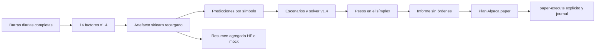

# Elección por convicción y asignación de capital

`->` Requisito incorporado el 12/11/2026: elegir una acción o combinación aunque no exista ventaja demostrada y sin diversificación obligatoria. Se aplica al Proyecto II en el repositorio del alumno; el repositorio de investigación [SwarmTrader v1.4.0](https://github.com/dalonsogomez-ai/swarmtrader/tree/5642dda71a1e50d55da3ad1206ec2ae1b891ac28) no se modifica. La leyenda de los marcadores está en el [README](README.md#leyenda-utilizada-en-la-wiki).

## Punto de partida en SwarmTrader v1.4

`>` En SwarmTrader, los *gates* G0–G4 son filtros estadísticos que deciden si una señal merece operarse. El modo upstream `gated` puede abstenerse: G4 comprueba si los primeros valores del ranking superan al universo, y la auditoría publicada de v1.4 da **«NO ACCIONABLE»**, es decir, no acredita esa ventaja. v1.4 ofrece además `--decision conviction`: el veredicto se informa, pero no veta la asignación. La incertidumbre no equivale a prohibir la elección, ni convierte las medias estimadas en certezas.

`~>` Esta entrega predice retornos con sklearn y aplica el optimizador de v1.4. **No recalcula G0–G4**: el informe copia la etiqueta fija `research_status: "NO ACCIONABLE / ventaja no demostrada"`, no una certificación estadística nueva. Las noticias, fundamentales, opciones y agentes profundos del original no forman parte del predictor académico: «universo analizado» significa exactamente los símbolos y las 14 features del CSV validado.

## Criterio matemático

`>` Con escenarios de retorno bruto positivos $X_{s,i} = 1 + R_{s,i}$ (escenario $s$, activo $i$), se resuelve:

```math
\max_{w \in \Delta^n} \; \frac{1}{S} \sum_{s=1}^{S} u_\gamma\!\left( \sum_{i} w_i X_{s,i} \right),
\qquad
\Delta^n = \Big\{ w \ge 0,\ \sum_i w_i = 1 \Big\}
```

`>` La utilidad es CRRA, con el logaritmo (criterio de Kelly) como caso $\gamma = 1$:

```math
u_\gamma(x) =
\begin{cases}
\log x & \gamma = 1 \\[4pt]
\dfrac{x^{1-\gamma} - 1}{1 - \gamma} & \gamma \ne 1
\end{cases}
```

`~>` Con $\gamma = 0$ se maximiza la riqueza esperada y se elige un vértice: el activo de mayor media. No se añade tope por activo, mínimo de posiciones, término que fuerce diversidad ni efectivo obligatorio. La formulación logarítmica y la comparación con carteras constantes se apoyan en [Cover, *Universal Portfolios*](https://isl.stanford.edu/~cover/papers/universal_portfolios.pdf); se adopta el criterio de elección, no sus garantías asintóticas para este predictor finito.

`>` En Kelly, por concavidad, las condiciones KKT son suficientes:

```math
\mathbb{E}\!\left[ \frac{X_i}{w^\top X} \right] = 1 \quad \text{si } w_i > 0,
\qquad
\mathbb{E}\!\left[ \frac{X_i}{w^\top X} \right] \le 1 \quad \text{si } w_i = 0
```

`~>` Por tanto, un vértice $w = e_j$ es óptimo si $\mathbb{E}[X_i / X_j] \le 1$ para todo $i$. Si alguna desigualdad se viola, mover capital a ese activo mejora el objetivo: una o varias posiciones aparecen por la función objetivo, no por una regla externa. Una combinación que reduce fluctuaciones puede aumentar el crecimiento geométrico aunque tenga menor media aritmética. Con $\gamma = 0$ solo cuenta la media: aunque todas sean negativas, se elige la menos negativa porque la inversión es completa. En empates exactos, el orden alfabético estabiliza el desempate numérico.

`>>` El solver upstream combina pasos multiplicativos y Frank–Wolfe y devuelve una brecha de suboptimalidad, con tolerancia `1e-7` en utilidad (no en rentabilidad). Los tests contrastan un vértice, una solución interior, medias negativas y una solución independiente con SciPy/SLSQP. «Óptimo» se refiere al problema finito de escenarios dentro de esa tolerancia; no certifica el mejor futuro real. Si `converged=false`, el informe conserva la brecha y no afirma convergencia.

`~>` Con `--mean-source model`, los pesos menores que `1e-4` se tratan como residuo numérico del solver: se anulan y el resto se renormaliza a 1 (`info.min_weight_reported`). El umbral equivale a menos de 1 USD sobre un nocional de 10.000 USD; en la demo elimina, por ejemplo, el peso de 9,7e-6 que el solver dejaba en DEMO07. El modo `empirical` conserva la salida upstream sin este filtro.

## Por qué no softmax, L1 ni un nuevo modelo de ranking

`~>` Softmax con temperatura positiva reparte peso entre todos los activos y nunca da ceros exactos; llevar la temperatura a cero selecciona un máximo, pero no decide cuándo una combinación mejora el crecimiento. [Sparsemax (Martins y Astudillo, ICML 2016)](https://proceedings.mlr.press/v48/martins16.html) sí proyecta sobre el símplex y produce ceros, pero no sustituye una distribución de escenarios y una utilidad. Una penalización L1 no selecciona nada en el símplex long-only, porque $\lVert w \rVert_1 = 1$ es constante; L0 crea un problema combinatorio innecesario para admitir concentración.

`~>` El ranking es una entrada de la decisión, no su función objetivo. Añadir ListNet o LambdaMART no garantiza un orden correcto ni probabilidades calibradas, y sumaría otro modelo que validar. Se reutilizan los especialistas de v1.4 y sklearn, conforme al enunciado. Máxima probabilidad de superar +5 %, máxima media y máximo crecimiento logarítmico son objetivos distintos y el informe no los confunde.

## Escenarios y dos fuentes de media

1. `>` `--mean-source model` (por defecto): las medias son los retornos predichos por sklearn. Se reutiliza `_ScenarioBank` de v1.4: bootstrap estacionario de secciones diarias, composición a 21 sesiones y mapa de incertidumbre estimado con validation fuera de muestra cada 21 fechas. Cada columna se reescala para que su media coincida exactamente con la predicción. La dependencia conjunta procede de hasta 1.260 sesiones de historia. Es una adaptación explícita: las medias no tienen calibración acreditada y un error del predictor afecta a la cartera. Como el nivel medio de las predicciones es constante por construcción (ver el [README](README.md#pipeline-con-inferencia)), lo que mueve la asignación es el orden relativo entre símbolos.
2. `>` `--mean-source empirical`: se llama íntegra a `allocate` del original, con mapa empírico por percentiles y encogimiento. Con universos de 8 a 10 símbolos no hay soporte para sus tramos: el mapa queda plano y el informe lo explica. Se puede elegir igualmente, pero no se atribuyen diferencias de media a los scores, y no se reduce el soporte mínimo para fabricar una ventaja.

`>>` Ambos modos usan semilla 0 y 3.000 escenarios por defecto. La fuente se elige explícitamente, queda registrada y no cambia según el resultado del test. `p_success` es la frecuencia de escenarios con retorno superior al 5 % en 21 sesiones: una estimación condicional, no una probabilidad calibrada. El mapa usa el mismo bloque de validation que eligió el modelo, así que **no es una auditoría independiente de la cartera**, y no se ha hecho un backtest fuera de muestra de esta asignación.

## Conexión de módulos



`=>` HF no decide los pesos: no recibe la cartera ni llama a herramientas financieras. El broker es un adaptador separado, y el predictor y el optimizador son funciones reutilizables por el Proyecto III.

## Órdenes Alpaca paper (fuera del enunciado)

`->` Adaptador opcional para llevar un informe a una cuenta de **prácticas** de Alpaca. No es un requisito del enunciado, no participa en los tests con credenciales reales ni en el CI, y nunca se ejecuta desde `run`. No se han usado credenciales reales ni se han enviado órdenes externas para verificar la entrega: las pruebas usan dobles locales.

`>` Credenciales solo **paper** en `.env`: `ALPACA_PAPER_API_KEY_ID` y `ALPACA_PAPER_API_SECRET_KEY`. Se usa [`TradingClient` de alpaca-py](https://alpaca.markets/sdks/python/trading.html) construido con `paper=True`; no hay URL live configurable.

```bash
python -m swarmtrade_app paper-plan --report runs/actual/report.json --output runs/actual/paper-plan.json
# Tras revisar el plan y con datos de la última sesión cerrada:
python -m swarmtrade_app paper-execute --plan runs/actual/paper-plan.json --journal runs/actual/paper-journal.json
# Para rotar posiciones anteriores, añadir --liquidate.
```

`>>` `runs/actual` representa un informe propio con datos vigentes: el CSV de septiembre de 2026 no cumple esa condición en noviembre y la demo sintética no define activos operables. `paper-plan` consulta cuenta, activos y reloj y guarda un plan; no compra. `paper-execute` es el paso explícito de envío a esa cuenta paper.

`~>` **Presupuesto sin préstamo.** No se interpreta el `buying_power` apalancado como efectivo propio:

```math
B = \left\lfloor \min(\text{cash},\ \text{buying\_power}) \cdot \left( 1 - \frac{\text{buffer\_bps}}{10\,000} \right) \right\rfloor_{\text{céntimo}}
```

`~>` El buffer técnico vale **0** por defecto (`--buffer-bps`) y no hay recorte de concentración: con un único peso 1 se asigna todo el presupuesto a esa acción. Los importes se redondean hacia abajo a céntimos y el residuo se suma al mayor importe. Los nocionales inferiores a 1 USD se reasignan por mínimo operativo, sin topes de riesgo, y el plan lo declara; este ajuste discreto puede apartar la orden del óptimo continuo en cuentas pequeñas.

`>` Se usa `MarketOrderRequest(notional=..., side=BUY, time_in_force=DAY)`, sin mezclar `qty` y `notional`. La [documentación de fracciones](https://docs.alpaca.markets/us/docs/fractional-trading) exige activos fraccionables y condiciones de orden admitidas. Antes de enviar se comprueban operabilidad, cuenta no bloqueada, sesión regular abierta, informe de la última sesión cerrada y ausencia de órdenes abiertas; el saldo se relee después de vender y antes de comprar.

`~>` Con posiciones previas, `--liquidate` las rota explícitamente: envía cierres y espera hasta 30 s a que desaparezcan antes de comprar. Un timeout o rechazo detiene las compras y deja el journal. No hay reintentos automáticos de órdenes. Los `client_order_id` derivan del plan y son estables aunque cambie el nombre del journal; ante un error ambiguo se reconcilia por esos IDs antes de reenviar. El estado `submitted_not_confirmed_filled` significa órdenes enviadas, no ejecuciones verificadas.

`=>` No se garantiza que una orden por el 100 % sea aceptada: precios, reservas y reglas del broker pueden cambiar entre la lectura y el envío. Se muestra la causa técnica y se conserva el estado parcial. El adaptador implementa órdenes de mercado diarias por nocional; no implementa órdenes limitadas, margen, cortos ni ejecución live.

## Evidencia reproducible

`>>` El [README](README.md#pipeline-con-inferencia) incluye comandos para comparar utilidades distintas con el mismo artefacto sintético, y los tests verifican la asignación y el adaptador paper sin acceso a un broker. Estas comprobaciones no acreditan ventaja económica ni ejecuciones externas.
